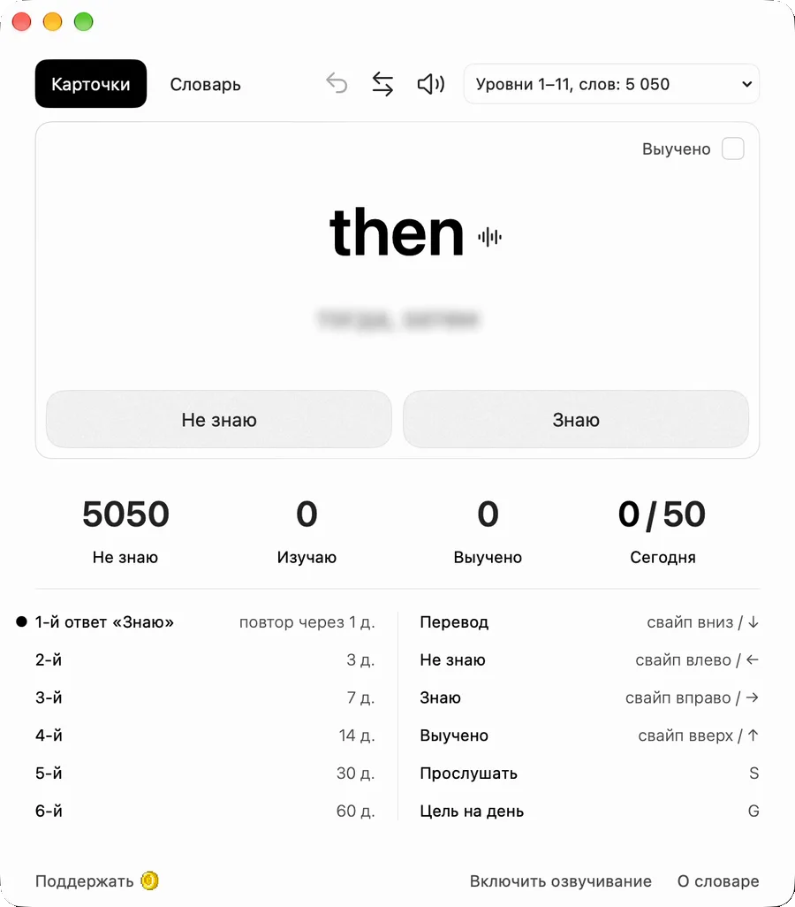
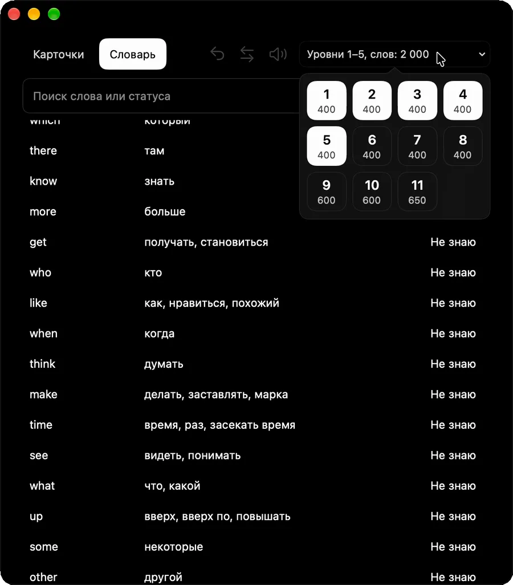

<h1 align="center">
   
  WordCard
</h1>

Изучение иностранных слов по карточкам с интервальным повторением.

- **Языки:** английский – 5050 слов с переводом на русский.
- **Уровни сложности:** от самых распространённых слов к более редким.
- **Перевод:** точное значение слова для каждой части речи.
- **Произношение:** качественное озвучивание слов.
- **Повторения:** через 1, 3, 7, 14, 30 и 60 дней.

---

  
  

---

**Стоимость:** бесплатно на 100%.

  

